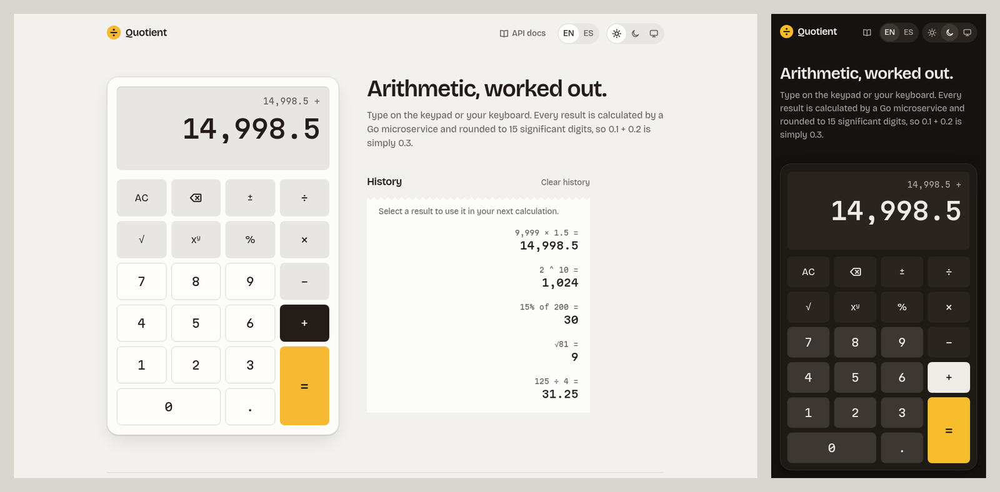

# Quotient

A full-stack calculator: a React + TypeScript frontend that sends every
calculation to a small Go REST service.



- Add, subtract, multiply, divide, plus power, square root and percentage
- Works from the on-screen keypad or the keyboard, on desktop and phone
- English and Spanish, with numbers formatted for each (`2.5` / `2,5`)
- Light, dark and system themes
- A history "tape" of past results that can be reused in the next calculation
- Clear, translated errors for division by zero, overflow and an unreachable API

## Quick start

With Docker, one command builds and runs everything on http://localhost:8080:

```sh
make docker-up          # or: docker compose up --build
```

If port 8080 is taken, pick another: `HOST_PORT=9090 make docker-up`.

The same image serves the app at `/`, the API at `/api/v1` and interactive API
docs at [`/docs`](http://localhost:8080/docs).

## Local development

Requirements: Go 1.27+, Node 22+ and pnpm 12.

```sh
make setup              # download Go modules and install frontend packages
make dev                # API on :8080 and Vite on http://localhost:5173
```

Vite proxies `/api` and `/docs` to the Go server, so the browser only ever
talks to one origin. To run each side on its own, use `make dev-backend` and
`make dev-frontend`.

| Command                | What it does                                             |
| ---------------------- | -------------------------------------------------------- |
| `make test`            | Unit tests for both layers                               |
| `make coverage`        | Coverage with HTML reports for both layers               |
| `make coverage-report` | Regenerates [`docs/coverage.md`](docs/coverage.md)       |
| `make lint`            | golangci-lint, ESLint and the TypeScript compiler        |
| `make fmt`             | gofmt and Prettier                                       |
| `make build`           | `backend/bin/api` and `frontend/dist`                    |
| `make docker-up`       | Builds and runs the full stack in one container          |
| `make help`            | Lists every target                                       |

### Configuration

The API reads its settings from the environment:

| Variable          | Default | Purpose                                                       |
| ----------------- | ------- | ------------------------------------------------------------- |
| `PORT`            | `8080`  | Port to listen on                                             |
| `ALLOWED_ORIGINS` | none    | Comma-separated origins allowed to call the API cross-origin  |
| `STATIC_DIR`      | none    | A built frontend to serve at `/` (set in the Docker image)    |
| `LOG_LEVEL`       | `info`  | `debug`, `info`, `warn` or `error`                            |
| `LOG_FORMAT`      | `text`  | `text` for people, `json` for log collectors                  |

Invalid values stop the server at startup with a message naming every problem.

## API

| Method | Path                             | Description                         |
| ------ | -------------------------------- | ----------------------------------- |
| `GET`  | `/api/v1/health`                 | Liveness probe                      |
| `GET`  | `/api/v1/operations`             | Supported operations and their arity |
| `POST` | `/api/v1/operations/{operation}` | Runs one operation                  |
| `GET`  | `/api/openapi.yaml`              | OpenAPI 3.1 contract                |
| `GET`  | `/docs`                          | Interactive API reference           |

Operations take their operands as a JSON array: two for `add`, `subtract`,
`multiply`, `divide`, `power` and `percentage`, one for `sqrt`.
`percentage` reads as "a% of b", so `[15, 200]` is 30.

```sh
curl -X POST localhost:8080/api/v1/operations/divide -d '{"operands": [10, 4]}'
# {"operation":"divide","operands":[10,4],"result":2.5}

curl -X POST localhost:8080/api/v1/operations/add -d '{"operands": [0.1, 0.2]}'
# {"operation":"add","operands":[0.1,0.2],"result":0.3}

curl -X POST localhost:8080/api/v1/operations/sqrt -d '{"operands": [2]}'
# {"operation":"sqrt","operands":[2],"result":1.4142135623731}

curl -X POST localhost:8080/api/v1/operations/percentage -d '{"operands": [15, 200]}'
# {"operation":"percentage","operands":[15,200],"result":30}

curl localhost:8080/api/v1/operations
# {"operations":[{"name":"add","symbol":"+","arity":2}, ...]}
```

Every error has the same shape, with a stable `code` to branch on and a
`message` for people:

```sh
curl -i -X POST localhost:8080/api/v1/operations/divide -d '{"operands": [1, 0]}'
# HTTP/1.1 422 Unprocessable Entity
# {"error":{"code":"division_by_zero","message":"cannot divide by zero"}}
```

| Status | Codes                                                                                      |
| ------ | ------------------------------------------------------------------------------------------ |
| 400    | `invalid_json`, `unknown_field`, `invalid_operand_count`, `invalid_operand`                |
| 404    | `unknown_operation`, `not_found`                                                           |
| 405    | `method_not_allowed`                                                                       |
| 413    | `payload_too_large` (bodies are capped at 1 KiB)                                           |
| 422    | `division_by_zero`, `negative_square_root`, `undefined_result`, `result_out_of_range`      |
| 500    | `internal_error`                                                                           |

## Tests and coverage

```sh
make test
make coverage-report    # writes docs/coverage.md
```

- **Backend:** table-driven tests for every operation and edge case, `httptest`
  tests for every status code and middleware, plus startup and graceful
  shutdown of the real binary. Run with the race detector.
- **Frontend:** Vitest and Testing Library. The calculator's state machine,
  number formatting and keyboard mapping are tested as pure functions;
  components are tested from the user's side against an MSW fake of the API.
  A locale test checks that English and Spanish have the same keys and a
  message for every API error code.

Edge cases are tested on purpose, because a calculator is easy to poke at:

- Division by zero (including `0 ÷ 0`, `-0` and divisors that underflow to
  zero), square roots of negatives, `(-8)^0.5`, `0^-1` and overflow past
  `1.8e308` all return a specific 4xx error. NaN and infinity never reach
  the response.
- Malformed bodies (`null` or string operands, `NaN` literals, trailing data,
  unknown fields, deeply nested JSON, bodies over 1 KiB) are rejected with a
  400, 413 or 404, never a 500.
- The frontend's state machine is driven by 20,000 seeded random key presses,
  with simulated API answers and failures, and must stay valid after each one.
- A 200 response without a numeric `result` shows an error, never
  `undefined` on the display.

The server's resilience limits (connection and body timeouts, body and header
size caps, panic recovery) and where DDoS protection belongs are covered in
[`docs/architecture.md`](docs/architecture.md#resilience).

Current numbers are in [`docs/coverage.md`](docs/coverage.md). CI
([`.github/workflows/ci.yml`](.github/workflows/ci.yml)) runs lint, tests with
coverage and the Docker build on every push.

## Project layout

```
backend/
  cmd/api/             entrypoint: config, logger, signals, healthcheck subcommand
  internal/calculator/ the domain: operations, rounding, errors (no HTTP)
  internal/httpapi/    routing, JSON, error mapping, middleware, SPA serving
  internal/config/     environment configuration
  internal/server/     http.Server timeouts and graceful shutdown
  api/openapi.yaml     the API contract, embedded in the binary
frontend/src/
  features/calculator/ api client, state machine, hooks and components
  shared/              HTTP client, theme, storage and UI primitives
  i18n/                i18next setup and the en/es messages
  styles/              design tokens and Tailwind theme
docs/                  architecture notes and the coverage report
```

## Design decisions

**The backend uses only the standard library.** Go 1.22+ routing patterns,
`log/slog` and `encoding/json` cover everything this service needs, so it
has no third-party runtime or test dependencies to audit or update.

**The domain knows nothing about HTTP.** `internal/calculator` is pure
functions and sentinel errors. `internal/httpapi` depends on it through a
two-method interface declared on the consumer side, maps its errors to status
codes, and is the only layer that knows about JSON. Adding a gRPC or CLI
front end would not touch the math.

**One endpoint per operation, operands as an array.**
`POST /api/v1/operations/{operation}` keeps each operation addressable (and
documented) on its own, while the array handles one- and two-operand
operations with one request shape. Unknown JSON fields, trailing data and
bodies over 1 KiB are rejected instead of ignored.

**Floats are rounded to 15 significant digits.** Results use `float64`, then
round to 15 digits, the most decimal digits that always survive a round trip
through a `float64`. That turns
`0.1 + 0.2` into `0.3` instead of `0.30000000000000004`. The trade-off is that
integers past 15 digits lose precision; a decimal library would fix that but
is more than a calculator of this scope needs. NaN and infinite results never
reach JSON: they become `undefined_result` and `result_out_of_range`.

**Errors are codes, and the frontend translates them.** The API's `message`
is in English for developers; the UI shows its own Spanish or English text
for each `code`. A 422 means the input was well formed but has no answer, as
opposed to a 400 for a malformed request.

**The calculator works like a desk calculator.** Operations chain left to
right as they are entered (`2 + 3 × 4` is 20), the way a physical calculator
does, rather than parsing a whole expression with precedence. Every result,
even `1 + 1`, comes from the API, because that is the point of the exercise.

**The state machine is a pure reducer.** It never calls the API. When the
user presses `=`, the reducer records the request it needs as data; the
`useCalculator` hook performs it, aborts it if the user clears, and feeds the
answer back. This keeps all the calculator rules testable without mocks. The
number being typed is kept as a string, so `0.`, `-0` and `2.50` look exactly
as typed.

**One container, one origin.** In Docker the Go binary also serves the built
frontend, so there is no CORS, no reverse proxy and no second process. The
image is distroless and runs as non-root; its healthcheck is the binary
itself (`api healthcheck`), since distroless has no shell or curl. CORS exists
only for local development, where Vite runs on another port.

**Brand.** Quotient takes its look from desk calculators: warm stone
neutrals, one saffron `=` key, and history printed like an adding machine's
paper tape. Colours are OKLCH design tokens with a light and dark value each,
checked for WCAG AA contrast. The fonts (Bricolage Grotesque and Martian Mono)
are bundled, so the app makes no third-party requests.

More detail, with diagrams, is in [`docs/architecture.md`](docs/architecture.md).

### Assumptions

- No accounts, rate limiting or persistence on the server: the API is
  stateless, and history lives in the browser's `localStorage`.
- Typed numbers are limited to 15 digits, the most a `float64` stores
  exactly, and results are rounded to 15 significant digits. Huge or tiny
  results switch to scientific notation.
- `/docs` loads the Scalar API reference from a CDN; everything else is
  self-contained.

## AI usage

This project was built with Claude Code. The prompts and how the work was
split between agents are in [`PROMPTS.md`](PROMPTS.md).
