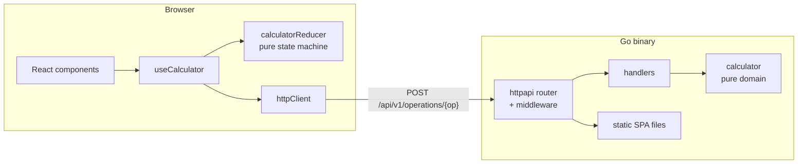
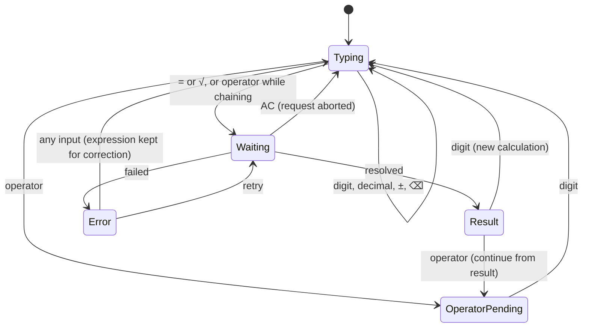
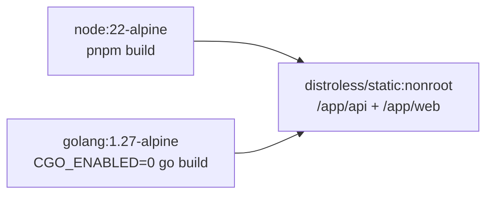

# Architecture

Quotient is two programs that meet at one HTTP contract,
[`backend/api/openapi.yaml`](../backend/api/openapi.yaml).



In development Vite serves the frontend on :5173 and proxies `/api` to the Go
server. In Docker the Go binary serves both, so the browser always sees one
origin.

## Backend

```
cmd/api            → wires config, logger, router and server; nothing else
internal/httpapi   → HTTP: routing, JSON in/out, error mapping, middleware
internal/calculator→ the math and its errors
internal/config    → environment variables, validated at startup
internal/server    → timeouts and graceful shutdown
```

Dependencies point inward only: `httpapi` imports `calculator`, never the
reverse. The handler depends on an interface declared in `httpapi`:

```go
type Calculator interface {
	Calculate(op calculator.Operation, operands []float64) (float64, error)
	Operations() []calculator.Descriptor
}
```

so a test can swap in a calculator that fails in ways the real one cannot,
which is how the "unexpected errors become a 500 without leaking details"
path is tested.

### A request, end to end

1. **Middleware**, outermost first: assign or propagate `X-Request-ID`, log
   the request when it finishes, recover from panics, set security headers,
   and (development only) answer CORS preflights.
2. **Routing.** Each route is registered for its method; the same path with
   any other method gets a JSON 405 with an `Allow` header instead of the
   standard library's plain-text default. Unknown `/api/` paths get a JSON
   404 rather than falling through to the SPA.
3. **Decoding.** The body is capped at 1 KiB, unknown fields and trailing
   data are rejected, and decoding failures map to `invalid_json`,
   `unknown_field` or `payload_too_large`.
4. **Domain.** `Calculate` checks the operation exists and has the right
   number of finite operands, applies it, turns NaN into `ErrUndefinedResult`
   and ±Inf into `ErrResultOutOfRange`, and rounds to 15 significant digits.
5. **Errors.** `fromDomain` maps each sentinel error to a status and code
   with `errors.Is`. Anything unrecognised becomes `internal_error` so
   internal messages never reach clients.

### Operations

| Operation    | Operands | Result         | Domain errors                            |
| ------------ | -------- | -------------- | ---------------------------------------- |
| `add`        | a, b     | a + b          | out of range                             |
| `subtract`   | a, b     | a − b          | out of range                             |
| `multiply`   | a, b     | a × b          | out of range                             |
| `divide`     | a, b     | a ÷ b          | division by zero, out of range           |
| `power`      | a, b     | aᵇ             | undefined (`(-8)^0.5`), out of range     |
| `sqrt`       | a        | √a             | negative square root                     |
| `percentage` | a, b     | a/100 × b      | out of range                             |

## Frontend

```
features/calculator/
  api/          typed client for the three endpoints
  model/        pure: reducer, entry editing, number formatting, key mapping
  hooks/        useCalculator, useHistory, useKeyboard, useApiStatus, formatting
  components/   Display, Keypad, Key, HistoryTape, ShortcutList, ApiStatusBadge
shared/         HTTP client and ApiError, theme provider, storage, UI primitives
i18n/           i18next with en and es messages
```

### The calculator state machine

`calculatorReducer` holds the whole calculator: the entry being typed, the
stored left operand, the pending operator, the last completed calculation and
any error. It is pure, so it cannot call the API. Instead, when a key needs a
result, it puts a **request** in state:

```ts
request: { id: 7, operation: 'add', operands: [2, 3], then: 'multiply' }
```

`useCalculator` watches for a new request, sends it, and dispatches
`resolved` or `failed` with the same `id`. Answers to any other id are
ignored, so a slow response that arrives after the user pressed AC cannot
overwrite the screen. Clearing also aborts the fetch.



`then` is how chaining works: pressing `×` after `2 + 3` asks for `2 + 3`,
and when 5 arrives it becomes the left operand of a pending multiplication.

After an error the expression stays on screen, so `8 ÷ 0` can be fixed with
backspace and a new digit. Network failures and timeouts show a retry button
that resends the exact failed request.

### Numbers and languages

The entry is a string while typed, so intermediate states like `0.` and
`-0` survive, and it is formatted for display with `Intl.NumberFormat` in the
active language. Integer parts go through `BigInt` so all 16 digits group
correctly. Results above 10¹⁶ or below 10⁻⁹ switch to scientific notation.
The keyboard accepts both `.` and `,` as the decimal separator.

Messages live in `i18n/locales/{en,es}.json`. A test fails if the two files
disagree on keys or interpolation variables, or if an API error code has no
message.

### History

Each successful calculation is added to a list of at most 50 entries in
`localStorage`. The stored data is treated as untrusted: entries that don't
match the current shape are dropped when it loads, and storage failures
(private mode, a full quota) never break the page.

## Delivery



The final image is about 19 MB. `HEALTHCHECK` runs `/app/api healthcheck`,
which calls `/api/v1/health` on localhost and exits non-zero on failure.
